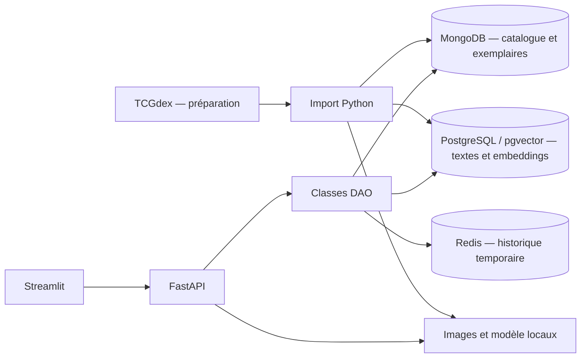

# Pokécollection

Application locale pour explorer une collection de cartes Pokémon en français, sans création de compte. Les données proviennent de TCGdex ; les exemplaires possédés et les achats sont simulés.

## Fonctionnalités

- Collection illustrée, fiches et filtres par nom, extension, type et rareté.
- Recherche en langage naturel : cinq cartes classées par distance cosinus.
- Dix dernières consultations par session anonyme, expiration après trente minutes d’inactivité.
- Nombre d’exemplaires, cartes distinctes, dépenses simulées et répartition par extension ou rareté.
- Consultation de la collection possible même si Redis ou la recherche sémantique sont indisponibles.

## Démarrer après clonage

Prérequis : Git et Docker Desktop avec Docker Compose, en mode conteneurs Linux. Les ports 8000 et 8501 doivent être disponibles. Aucune installation locale de Python ni clé API n’est nécessaire. La première préparation nécessite une connexion Internet et suffisamment de mémoire pour la stack Docker (prévoir environ 5 Go disponibles).

```powershell
git clone https://github.com/DorianArg/pkmn_app.git
cd pkmn_app
docker compose -f docker-compose.yml -f docker-compose.pokemon.yml --profile tous up -d --build
docker exec python python /projet/importer.py
```

Attendre la fin de l’import, puis ouvrir :

- **Tableau de bord : http://localhost:8501**
- Documentation de l’API : http://localhost:8000/docs

La démo par défaut prépare les extensions Set de Base, Jungle et Fossile, avec 360 exemplaires simulés. Lors de la préparation du 5 novembre 2026 : 228 fiches importées, dont 189 cartes Pokémon distinctes dans la collection ; deux illustrations absentes de la source. Les volumes peuvent évoluer chez TCGdex.

Les données, images et modèles ne sont pas inclus dans Git. Ils sont téléchargés dans `travail/pokemon/`, et les bases persistent dans des volumes Docker. Après la première préparation, la collection et la recherche fonctionnent sans accès à TCGdex ni Hugging Face. Pour reconstruire les données depuis le cache :

```powershell
docker exec python python /projet/importer.py --hors-ligne
```

## Architecture



| Composant | Rôle | Responsable |
|---|---|---|
| MongoDB | Référence durable, filtres et statistiques calculées par agrégation | Mario |
| PostgreSQL / pgvector | Index sémantique dérivé, recherche limitée aux cartes possédées | Swann |
| Redis | Liste des consultations avec doublons, limite de dix et TTL renouvelé | Dorian |

Les écritures MongoDB utilisent `writeConcern: majority`. Le modèle multilingue E5 est exécuté localement avec ONNX Runtime. Les images sont servies par l’API locale ; l’interface n’interroge jamais directement les bases.

## Commandes utiles

```powershell
# Journaux des deux services applicatifs
docker compose -f docker-compose.yml -f docker-compose.pokemon.yml logs -f python

# Tests unitaires : aucune donnée téléchargée requise
docker exec -e PYTHONPATH=/projet python python -m unittest discover -s /projet/tests -v

# Tests d’intégration : après l’import, avec les trois bases démarrées
docker exec -e PYTHONPATH=/projet -e POKEMON_INTEGRATION=1 python python -m unittest discover -s /projet/tests -v

# Vérification du parcours Streamlit avec l’API démarrée
docker exec python python /projet/tests/verifier_interface.py

# Arrêt en conservant les données
docker compose -f docker-compose.yml -f docker-compose.pokemon.yml --profile tous stop
```

Le workflow GitHub Actions vérifie la syntaxe et les tests unitaires. Les tests d’intégration sont exécutés localement après préparation de la démo.

## Organisation et limites

Le [guide détaillé](projet/LISEZMOI.md) décrit l’import, les DAO, les choix CAP, la dégradation des services et le parcours de démonstration.

- `projet/pokemon/` : connexions, DAO, normalisation et embeddings.
- `projet/api.py` et `projet/tableau_de_bord.py` : API et interface.
- `projet/importer.py` : préparation relançable et génération des exemplaires.
- `python/`, `config/` et les fichiers Compose : environnement Docker.
- `travail/j1`, `travail/j2`, `travail/j4` et `projet/nyc_eats/` : sources pédagogiques originales, conservées comme référence. Les jeux de données restaurants restent locaux et ne sont pas nécessaires à l’application Pokémon.

La recherche porte sur les textes disponibles, pas sur les illustrations. Les achats simulés ne représentent pas une valeur marchande. Une nouvelle session de navigateur peut démarrer un nouvel historique. L’import n’est pas une transaction distribuée : le réaliser avant la démonstration.

## Sources

- [TCGdex](https://tcgdex.dev/fr/) : fiches françaises et illustrations.
- [E5 multilingue](https://huggingface.co/intfloat/multilingual-e5-small) et [conversion ONNX](https://huggingface.co/Xenova/multilingual-e5-small) : modèle de recherche, licence MIT.

Projet pédagogique non officiel. Les cartes, illustrations et marques Pokémon appartiennent à leurs ayants droit. L’aide de l’IA à l’implémentation doit être mentionnée dans la présentation, conformément au livret du projet.
