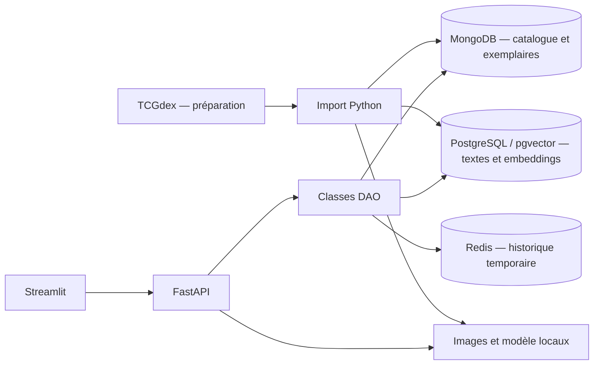

# Pokécollection

Application locale pour explorer le catalogue Pokémon français et constituer une collection persistante, sans création de compte. Les données proviennent de TCGdex ; la collection commence vide et se remplit uniquement avec vos ajouts.

Dépôt du projet : [ayala2a/projet-pokemon](https://github.com/ayala2a/projet-pokemon).

## Fonctionnalités

- Catalogue illustré avec pagination et filtres par bloc, extension, nom, type et rareté.
- Sélection de cartes et ajout à la collection en un clic, plusieurs exemplaires possibles.
- Retrait d’un exemplaire et informations facultatives : état, variante, prix d’achat.
- Suppression groupée dans « Ma collection » : cocher les cartes puis « Supprimer la sélection ». Tous leurs exemplaires sélectionnés sont retirés ; le catalogue et les embeddings sont conservés.
- Recherche en langage naturel : jusqu’à cinq cartes possédées, retenues sous un seuil de distance cosinus calibré, sans compléter les résultats éloignés. [Méthode et limites](docs/RECHERCHE.md).
- Dix dernières cartes distinctes consultées par session anonyme, expiration après trente minutes d’inactivité. Revoir une carte la remet en tête.
- Nombre d’exemplaires, cartes distinctes, achats renseignés et répartition par extension ou rareté.
- Consultation de la collection possible même si Redis ou la recherche sémantique sont indisponibles.
- Mode développeur : console des requêtes réelles HTTP, DAO, MongoDB, pgvector et Redis, isolée par session.

## Console développeur

Activer **Mode développeur** dans la barre latérale : la console apparaît sous la page courante, **requêtes les plus récentes en premier**. Les appels `/images/...` sont masqués par défaut ; une case permet de les afficher. Chaque requête conserve son identifiant HTTP, sa méthode, sa route, son statut et sa durée. Les événements d'une même opération sont rapprochés par un identifiant backend pour présenter ensemble la méthode DAO, la commande exécutée, les paramètres utiles, le résultat et la durée. Les opérations restent dans l'ordre d'exécution à l'intérieur de la requête.

Les blocs des bases montrent notamment les écritures MongoDB d'ajout/retrait, le pipeline réel d'agrégation des statistiques et le writeConcern ; les SQL pgvector, références possédées, meilleur passage comparé par carte, distances, seuil et décisions accepté/rejeté ; les commandes Redis, la clé et le contenu effectivement lu de la liste avec longueur et TTL. Les détails HTTP, DAO et de l'encodage restent dépliables. **Actualiser les traces** et **Effacer la console** ne relancent pas les actions de la page et ne modifient aucune donnée métier.

Les traces sont conservées uniquement en mémoire du backend : au plus 40 requêtes métier et 12 requêtes d'images, et 1 Mo par session, pendant 30 minutes sans requête tracée, pour 16 sessions récentes au maximum. Les images ne remplacent donc pas les requêtes métier dans la limite des quarante. Les événements et résultats volumineux sont explicitement abrégés. Un jeton aléatoire propre à la session, transmis en en-tête et jamais affiché, isole l'accès à la console. Les secrets sont masqués et les vecteurs limités à leur dimension et quatre valeurs. Redémarrer l'API efface ces traces.

Le mode développeur observe les parcours existants sans modifier leurs résultats : il ajoute uniquement des lectures de diagnostic PostgreSQL pour les candidats et Redis pour `LRANGE`/`LLEN`/`TTL`. Après une consultation, ces lectures Redis s'effectuent dans la transaction existante, après les commandes métier, pour montrer le contenu observé à cet instant. Elles ne changent pas le délai d'expiration. Les lectures d'images passent alors réellement par l'API locale pour être traçables ; hors mode développeur, le cache Streamlit reste utilisé. Aucun accès à TCGdex n'est ajouté. Les durées HTTP indiquent le traitement jusqu'aux en-têtes de réponse, sans inclure le transfert des fichiers image. Les durées SQL incluent l'exécution et la récupération des lignes effectivement lues.

## Démarrer après clonage

Prérequis : Git et Docker Desktop avec Docker Compose, en mode conteneurs Linux. Les ports 8000 et 8501 doivent être disponibles. Aucune installation locale de Python ni clé API n’est nécessaire. La première préparation nécessite une connexion Internet et suffisamment de mémoire pour la stack Docker (prévoir environ 5 Go disponibles).

```powershell
git clone https://github.com/ayala2a/projet-pokemon.git
cd projet-pokemon
docker compose -f docker-compose.yml -f docker-compose.pokemon.yml --profile tous up -d --build
docker exec python python /projet/importer.py
```

Attendre la fin de l’import, puis ouvrir :

- **Tableau de bord : http://localhost:8501**
- Documentation de l’API : http://localhost:8000/docs

L’import par défaut prépare un premier lot des extensions Set de Base, Jungle et Fossile du bloc Base, limité à 240 fiches. Le périmètre réellement disponible est affiché dans le catalogue, sous « Extensions disponibles ». Sélectionnez vos cartes pour constituer la collection. Les imports ne génèrent aucun exemplaire et préservent tous vos ajouts existants.

Importer un autre bloc ou toutes les extensions d’un bloc, avant la démonstration :

```powershell
# Début d’un bloc, au maximum 240 fiches
docker exec python python /projet/importer.py --blocs base --limite 240

# Tout le bloc, sans limite ; téléchargement plus long
docker exec python python /projet/importer.py --blocs base --limite 0
```

Les imports sont cumulatifs : ils enrichissent le catalogue et son index sémantique, sans supprimer les exemplaires, les autres extensions ou les vecteurs déjà préparés. Aucun calcul d’embedding n’est lancé lorsqu’une carte est ajoutée à la collection.

Le catalogue enrichi contient **3 174 cartes Pokémon françaises** : **EX (`ex`), Diamant & Perle (`dp`), Platine (`pl`) et HeartGold SoulSilver (`hgss`)**, ainsi que Base conservé et complété avec les extensions françaises disponibles. Pour reproduire ce périmètre après l’import initial :

```powershell
docker exec python python /projet/importer.py --blocs base,ex,dp,pl,hgss --limite 0
```

Cette commande retient des extensions entières. Une relance reprend les fiches/images du cache et ne calcule un embedding que si le texte normalisé ou la révision du modèle a changé, ou si le vecteur manque. Chaque lot de vecteurs est sauvegardé pour permettre une reprise après interruption. Le bilan JSON détaillé se trouve dans `travail/pokemon/bilan_import.json`, avec le périmètre cumulé, les images manquantes et les cartes réellement indexées par bloc.

Le [bilan du catalogue enrichi](docs/CATALOGUE.md) détaille les extensions retenues et les 3 064 cartes disponibles pour la recherche sémantique. Lors de ce bilan, les 3 174 cartes disposent d’une image locale : 2 428 scans français et 746 scans anglais de secours. Le détail par extension est consultable dans le catalogue ; les textes des fiches restent en français.

La recherche compare séparément le nom, la description et chaque effet d’attaque/capacité. Elle affiche le passage le plus proche pour expliquer chaque résultat ; un effet court comme « Piochez une carte » n’est plus noyé dans toute la fiche. La recherche reste limitée aux cartes possédées.

Les données, images et modèles ne sont pas inclus dans Git. Ils sont téléchargés dans `travail/pokemon/`, et les bases persistent dans des volumes Docker. Après la première préparation, la collection et la recherche fonctionnent sans accès à TCGdex ni Hugging Face. Pour reconstruire les données depuis le cache :

```powershell
docker exec python python /projet/importer.py --blocs base,ex,dp,pl,hgss --limite 0 --hors-ligne
```

## Architecture



| Composant | Rôle | Responsable |
|---|---|---|
| MongoDB | Référence durable, filtres et statistiques calculées par agrégation | Mario |
| PostgreSQL / pgvector | Index sémantique dérivé, recherche limitée aux cartes possédées | Swann |
| Redis | Dix dernières cartes distinctes, remises en tête à chaque consultation, avec TTL renouvelé | Dorian |

Les écritures MongoDB utilisent `writeConcern: majority`. Le modèle multilingue E5 est exécuté localement avec ONNX Runtime. Les images sont servies par l’API locale ; l’interface n’interroge jamais directement les bases.

## Commandes utiles

```powershell
# Journaux des deux services applicatifs
docker compose -f docker-compose.yml -f docker-compose.pokemon.yml logs -f python

# Tests unitaires : aucune donnée téléchargée requise
docker exec -e PYTHONPATH=/projet python python -m unittest discover -s /projet/tests -v

# Tests d’intégration : après l’import, avec les trois bases démarrées
docker exec -e PYTHONPATH=/projet -e POKEMON_INTEGRATION=1 python python -m unittest discover -s /projet/tests -v

# Vérification du parcours Streamlit avec l’API démarrée
docker exec python python /projet/tests/verifier_interface.py

# Arrêt en conservant les données
docker compose -f docker-compose.yml -f docker-compose.pokemon.yml --profile tous stop
```

Le workflow GitHub Actions vérifie la syntaxe et les tests unitaires. Les tests d’intégration sont exécutés localement après préparation de la démo.

## Organisation et limites

Le [guide détaillé](projet/LISEZMOI.md) décrit l’import, les DAO, les choix CAP, la dégradation des services et le parcours de démonstration.

```text
projet-pokemon/
├── projet/
│   ├── api.py                  # API FastAPI
│   ├── tableau_de_bord.py      # Interface Streamlit
│   ├── lancer.py               # Lancement des deux services
│   ├── importer.py             # Import du catalogue et préparation locale
│   ├── pokemon/                # DAO, connexions, embeddings et traces
│   └── tests/                  # Tests existants
├── python/                     # Image Docker et dépendances Python
├── config/                     # Initialisation du replica set MongoDB
├── docs/                       # Bilans et calibration de la recherche
├── travail/pokemon/            # Cache, images et modèle locaux, hors Git
├── docker-compose.yml
└── docker-compose.pokemon.yml
```

- `projet/pokemon/` : connexions, DAO, normalisation et embeddings.
- `projet/api.py` et `projet/tableau_de_bord.py` : API et interface.
- `projet/importer.py` : préparation relançable du catalogue, des images et des embeddings, sans modifier les exemplaires.
- `python/`, `config/` et les fichiers Compose : environnement Docker.
- `travail/j1`, `travail/j2`, `travail/j4` et `projet/nyc_eats/` : sources pédagogiques originales, conservées comme référence. Les jeux de données restaurants restent locaux et ne sont pas nécessaires à l’application Pokémon.

La recherche porte sur les textes disponibles, pas sur les illustrations. Les prix d’achat facultatifs ne représentent pas une estimation de valeur marchande. Une nouvelle session de navigateur peut démarrer un nouvel historique. L’import n’est pas une transaction distribuée : le réaliser avant la démonstration.

Une collection vide affiche zéro exemplaire, zéro carte distincte et zéro achat renseigné. Les graphiques présentent un état vide et la recherche invite à ajouter des cartes ; le catalogue reste entièrement accessible. Aucun nettoyage de la collection ou de Redis n’est exécuté au démarrage ou à l’import.

La collection est partagée sur cette installation et persiste dans MongoDB ; seule la liste Redis des consultations dépend de la session. Pour la démonstration : **catalogue → filtre bloc/extension → sélection → ajout → Ma collection et statistiques → recherche par sens → historique**.

## Sources

- [TCGdex](https://tcgdex.dev/fr/) : fiches françaises et illustrations.
- [E5 multilingue](https://huggingface.co/intfloat/multilingual-e5-small) et [conversion ONNX](https://huggingface.co/Xenova/multilingual-e5-small) : modèle de recherche, licence MIT.

Projet pédagogique non officiel. Les cartes, illustrations et marques Pokémon appartiennent à leurs ayants droit. L’aide de l’IA à l’implémentation doit être mentionnée dans la présentation, conformément au livret du projet.
